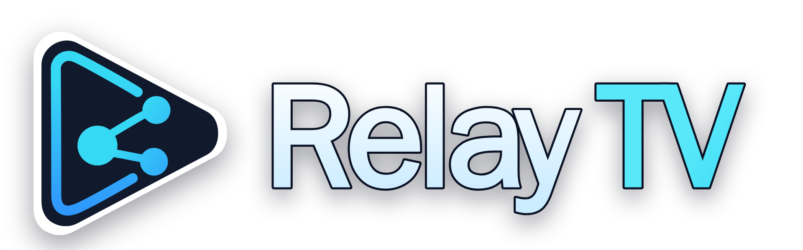
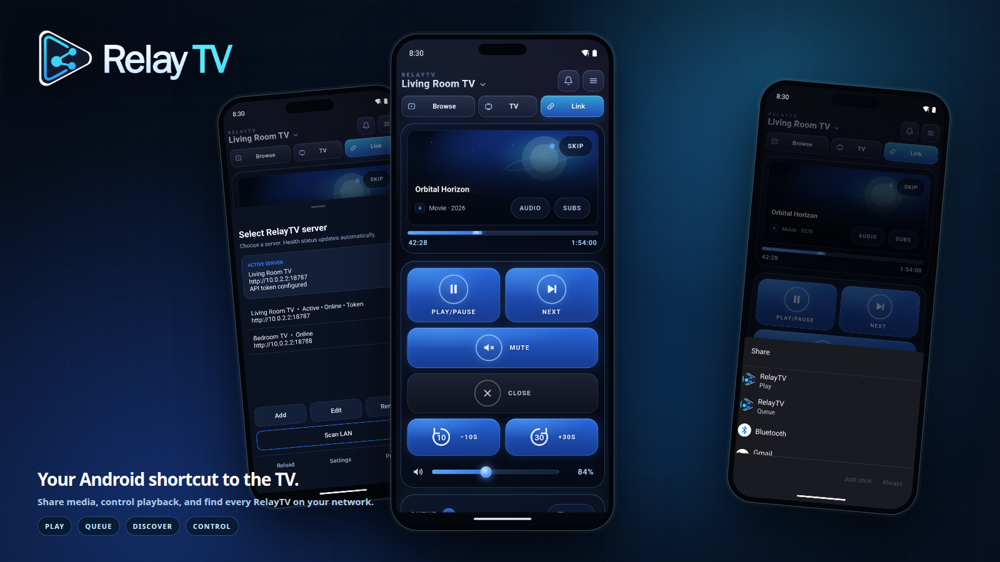
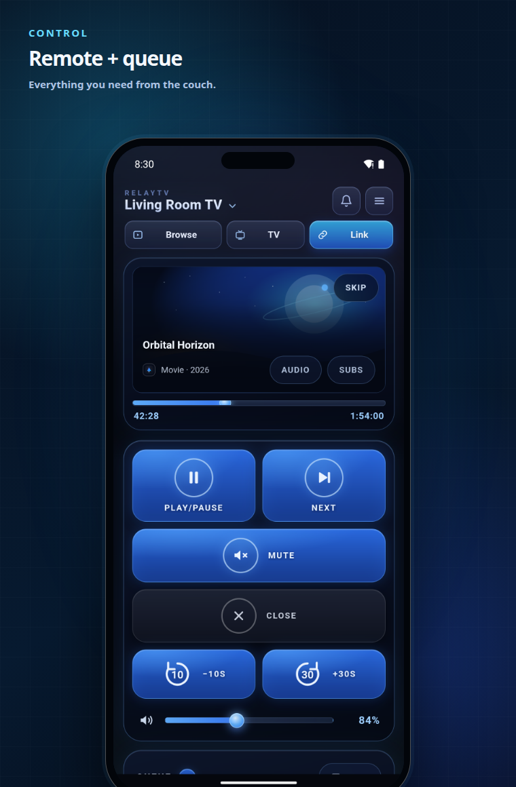
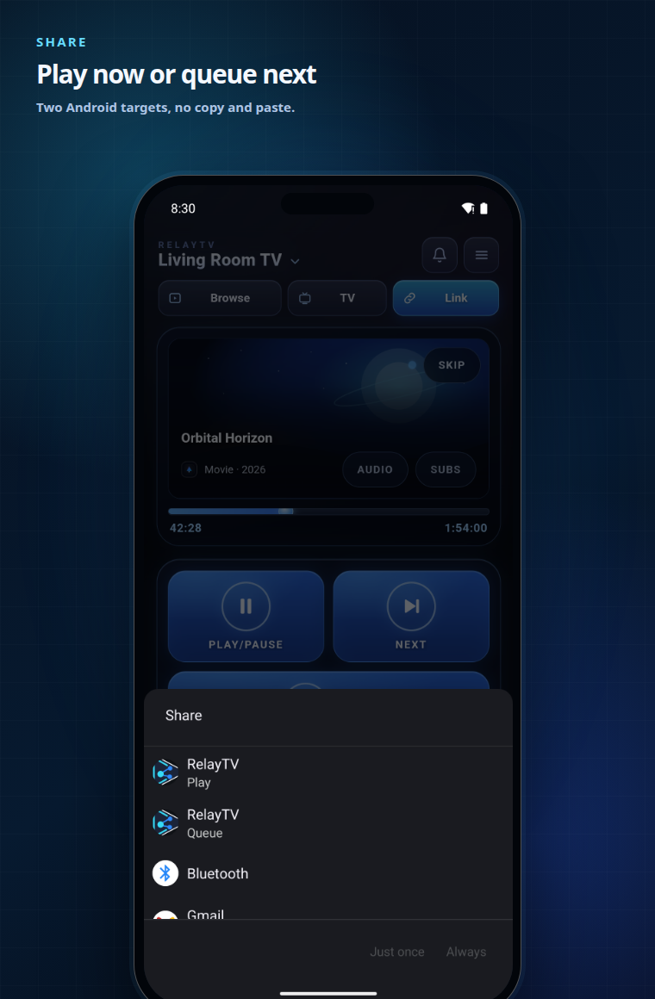
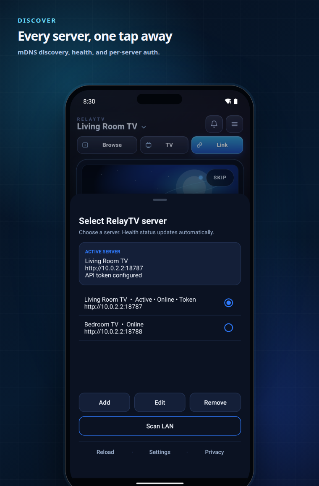
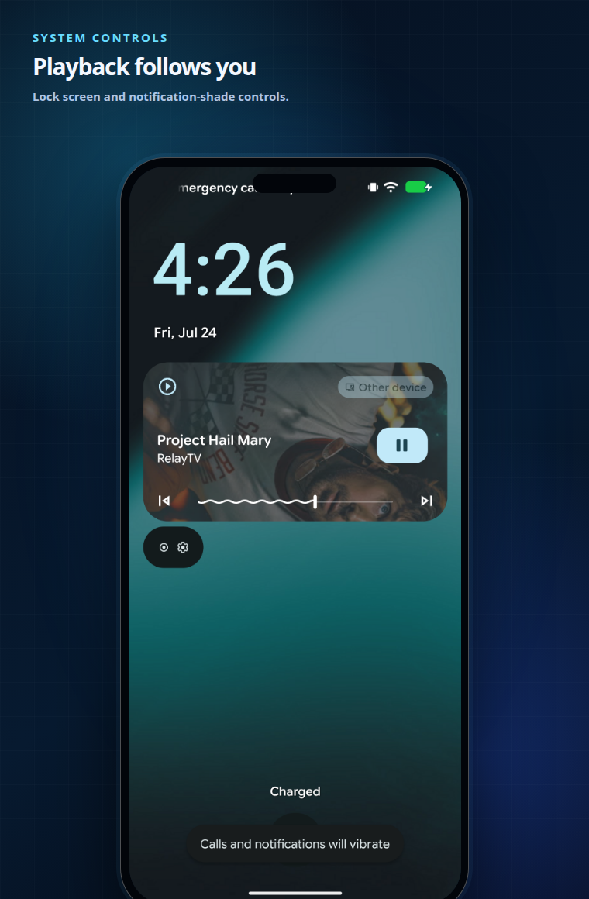

  

<h1 align="center">Share it. Queue it. Watch it.</h1>

  Turn your Android phone into the fastest path to your self-hosted RelayTV:
  share media from any app, control the TV, and discover every RelayTV server
  on your network.

  <a href="#install-in-minutes"><strong>Install</strong></a> ·
  <a href="#see-it-in-action"><strong>See it in action</strong></a> ·
  <a href="#operator-and-network-guide"><strong>Operator guide</strong></a> ·
  <a href="docs/DEVELOPMENT.md"><strong>Development</strong></a> ·
  <a href="https://github.com/mcgeezy/relaytv-android/releases"><strong>Releases</strong></a> ·
  <a href="https://github.com/mcgeezy/relaytv"><strong>RelayTV server</strong></a>

  
  
  
  
  

  

  <strong>Local-first</strong> · No RelayTV account · No tracking · Optional
  bearer-token authentication

## Your phone becomes the remote

### Send it

Share a web link, playlist, `rtsp://` or `rtsps://` stream, or compatible local
video or audio file from Android—or tap an RTSP link directly—and choose
**Play** to start it immediately or **Queue** to line it up next. No copying a
URL, opening another app, or walking back to the TV.

### Control it

Open the complete frameless RelayTV web remote inside the app. Play, pause,
seek (including live DVR buffers), skip, adjust TV volume, manage the queue,
and browse **Plex, Jellyfin, Emby, Seerr requests, or live IPTV** from one
screen. RelayTV also publishes native lock-screen and quick-settings media
controls for your active server.

### Find it

RelayTV servers announce themselves over `_relaytv._tcp` mDNS. Scan the LAN,
verify server health, switch between multiple rooms or screens, and store an
optional API token with each server profile.

The Android app stays lightweight while the RelayTV box beside the television
owns playback, queue advancement, history, and the display runtime.

## See it in action

<table>
  <tr>
    <td width="50%" valign="top">
      
    </td>
    <td width="50%" valign="top">
      
    </td>
  </tr>
  <tr>
    <td valign="top">
      <h3>Everything you need from the couch</h3>
      Control current playback, seek, change volume, manage the queue, and open
      your full RelayTV library experience in an edge-to-edge native wrapper.
    </td>
    <td valign="top">
      <h3>Two targets, zero friction</h3>
      Send links, playlists, RTSP streams, and local audio or video files
      directly from the Android share sheet. Play immediately or queue for later.
    </td>
  </tr>
</table>

<table>
  <tr>
    <td width="50%" valign="top">
      
    </td>
    <td width="50%" valign="top">
      
    </td>
  </tr>
  <tr>
    <td valign="top">
      <h3>Every RelayTV screen, one tap away</h3>
      Keep several servers in one app, check online status at a glance, switch
      active screens, and discover new RelayTV devices without typing an IP.
    </td>
    <td valign="top">
      <h3>Playback controls that follow you</h3>
      RelayTV publishes the active server as an Android media session, putting
      artwork, play/pause, previous, next, seek, and remote volume on your lock
      screen and notification shade.
    </td>
  </tr>
</table>

## Install in minutes

1. Install and configure a [RelayTV server](https://github.com/mcgeezy/relaytv).
2. Download the latest `relaytv-v*.apk` from [GitHub Releases](https://github.com/mcgeezy/relaytv-android/releases).
3. Allow installation from the browser or file manager you used to download it.
4. Open RelayTV and tap **Scan LAN**, or tap **Add** to enter a server URL manually (for example `http://10.0.55.2:8787` or `https://tv.example.com`).
5. Enter the server **API token** only if `RELAYTV_API_TOKEN` is enabled on that server.
6. Allow the Android **Notifications** prompt (Android 13+) so share results and lock-screen media controls can appear.

> **Upgrading from v1.3.1 or earlier:** Early GitHub builds were signed with a
> debug key. Note your saved server URLs, uninstall the older APK once, and
> install the current release APK to move onto the stable release signing key.
> All newer GitHub release APKs upgrade in place.

Before saving a profile, RelayTV checks that the server is reachable and—when
authentication is enabled—verifies your API token.

## Using RelayTV Android

### Navigating the remote and switching servers

- **Frameless header (RelayTV server v0.13.0+):** Tap the **server name** in the top header to open the **Server Picker** bottom sheet, or open the header menu for **Switch server**, **App settings**, **Reload**, and **Privacy policy**. System status and navigation bars automatically match your RelayTV Auto, Dark, or Light theme.
- **Offline or legacy server pill:** If the active server goes offline or runs an older RelayTV version without the mobile header bridge, a floating pill appears near the bottom of the screen so you can still switch servers, reload, or open settings.
- **External sign-in flows:** Third-party authentication links (such as Plex sign-in) open in your default Android browser while keeping RelayTV navigation inside the app.

### Sharing from Android

Android shows two RelayTV targets whenever you share compatible content or open an RTSP stream link:

| Target | What it does | Supported inputs |
| --- | --- | --- |
| **Play** | Starts playback immediately on the active RelayTV server | Web video/audio URLs, playlists, `rtsp://` / `rtsps://` streams, and local media files |
| **Queue** | Appends the item (or playlist) to the active server's queue | Web video/audio URLs, playlists, `rtsp://` / `rtsps://` streams, and local media files |

- **Supported local upload formats:** `MP4`, `M4V`, `WebM`, `MP3`, `M4A`, `AAC`, `WAV`, `FLAC`, `OGG`, and `OPUS`. The RelayTV server performs final MIME validation and ingest processing.
- **Direct stream links:** Tapping an `rtsp://` or `rtsps://` link in another app offers **Play** and **Queue** directly without opening the share sheet first.
- **First-run safeguard:** Sharing before any server is configured opens the Server Picker so you can connect a server first.

### Lock-screen and quick-settings media controls

- Enabled by default and toggleable at any time under **App settings → Media controls**.
- Mirrors track title, server name, artwork, playback position, live DVR seek windows, and remote server volume (`0–100%`)—no audio plays on your phone.
- Designed for low battery impact: updates arrive over local push (`WebSocket`, then `SSE`) whenever available, and the background media session stops itself automatically once playback has been idle for 5 minutes or unreachable for 90 seconds.

## Operator and network guide

### LAN discovery (`_relaytv._tcp`)

- **Scan LAN** listens for `_relaytv._tcp` mDNS announcements on your current Wi-Fi broadcast domain (IPv4 and IPv6).
- mDNS does not cross routed subnets, isolated guest Wi-Fi, or most VPN tunnels by default. In segmented or remote setups, add the server manually using `host:port` (defaults to `http://`) or a full `http://` / `https://` URL.

### API token authentication (`RELAYTV_API_TOKEN`)

- Leave **API token** blank for trusted, unauthenticated LAN servers.
- When `RELAYTV_API_TOKEN` is set on a RelayTV server, add that token to its profile in the Server Picker (**Add** or **Edit**).
- The same stored profile token authenticates embedded WebView actions, Android shares, local file uploads, and native lock-screen media controls for that server.

### Reverse proxies and HTTPS

- Cleartext `http://` works out of the box for private LAN and VPN addresses; use `https://` whenever exposing a server beyond a trusted private network.
- **WebSocket upgrades:** Current RelayTV servers push realtime state over `/ui/ws` (`wss://` over HTTPS) using `Sec-WebSocket-Protocol: relaytv.realtime.v1`. Ensure your reverse proxy (Caddy, Nginx, Traefik, Cloudflare, or Tailscale Serve) forwards `Upgrade`, `Connection`, and `Sec-WebSocket-Protocol` headers and keeps read timeouts above the server heartbeat (`~5s` default).
- **Automatic transport fallback:** If a proxy or network path blocks WebSockets, both the WebView and native media controls automatically fall back to Server-Sent Events (`/ui/events`, disable proxy response buffering) and then adaptive HTTP polling.
- **Upload body limits:** If you share local video or audio files through a reverse proxy, set its maximum request body size (for example Nginx `client_max_body_size`) high enough for your media files.

### VPNs and remote access (Tailscale, WireGuard)

- Share jobs dispatch immediately without waiting for Android's internet-validation check (`NET_CAPABILITY_VALIDATED`), so sharing works reliably on air-gapped LANs, Tailscale, and split- or full-tunnel WireGuard networks.
- You can save separate profiles for home and away (for example `Living Room (LAN)` and `Living Room (Tailscale)`) or use a single MagicDNS / split-DNS hostname that resolves everywhere.

## Troubleshooting

- **Scan LAN finds no servers:** Confirm your phone and RelayTV host are on the same Wi-Fi VLAN, AP client isolation is disabled, and UDP port `5353` multicast is permitted. Otherwise, add `http://<server-ip>:8787` manually.
- **Share or media-control notifications do not appear:** On Android 13+, confirm **Notifications** are allowed for RelayTV in system App Info, and check **App settings → Media controls**.
- **Package conflict when installing a new APK:** If upgrading from `v1.3.1` or earlier, uninstall the older debug-signed build once before installing the release-signed APK.
- **Media controls lag or disconnect behind a proxy:** Verify `/ui/ws` forwards WebSocket upgrade headers and `Sec-WebSocket-Protocol`, or disable proxy buffering on `/ui/events`.

## Security and privacy

- No RelayTV cloud account, analytics service, or advertising SDK.
- Server profiles and optional API tokens stay in app-private storage excluded from Android cloud backup and device-to-device transfer.
- API tokens are sent only as `Authorization: Bearer` headers (and scoped to the matching server origin inside the embedded WebView).
- Shared URLs have embedded credentials and common auth query tokens redacted before appearing in local Android notifications.
- Shared local media files are staged in private cache only for upload and cleaned up automatically afterward.

Read the full [privacy policy](docs/PRIVACY_POLICY.md) for complete data-handling and permission details.

## Compatibility

- **Android:** Android 8.0 (Oreo) or newer
- **Server connectivity:** Reachable RelayTV server over LAN, VPN, or HTTPS
- **UI bridge:** Full frameless header and theme sync with RelayTV server `v0.13.0+`; older servers remain supported via the floating server pill
- **Upgrade flexibility:** Forward- and backward-compatible realtime sync (`WebSocket` → `SSE` → HTTP polling), so server and Android app updates never have to be synchronized

## Contributing and development

Architecture notes, server API and WebView bridge contracts, local SDK/Gradle build scripts, screenshot generation, and Release Please CI workflows are documented in **[docs/DEVELOPMENT.md](docs/DEVELOPMENT.md)**.

## Companion projects

- **[RelayTV server](https://github.com/mcgeezy/relaytv)**: the local playback engine, queue, web UI, and TV runtime.
- **[RelayTV for Home Assistant](https://github.com/mcgeezy/relaytv-ha)**: media-player entities, services, dashboards, and automations.

## Project and support

RelayTV Android is open-source software licensed under the
[GNU General Public License v3.0](LICENSE).
RelayTV artwork and marks are covered by the core project's
[asset and trademark policy](https://github.com/mcgeezy/relaytv/blob/main/ASSETS.md).

If RelayTV makes your living-room setup better, you can help by
[starring the repository](https://github.com/mcgeezy/relaytv-android), sharing
it with another self-hoster, or
[supporting development](https://buymeacoffee.com/relaytv).
